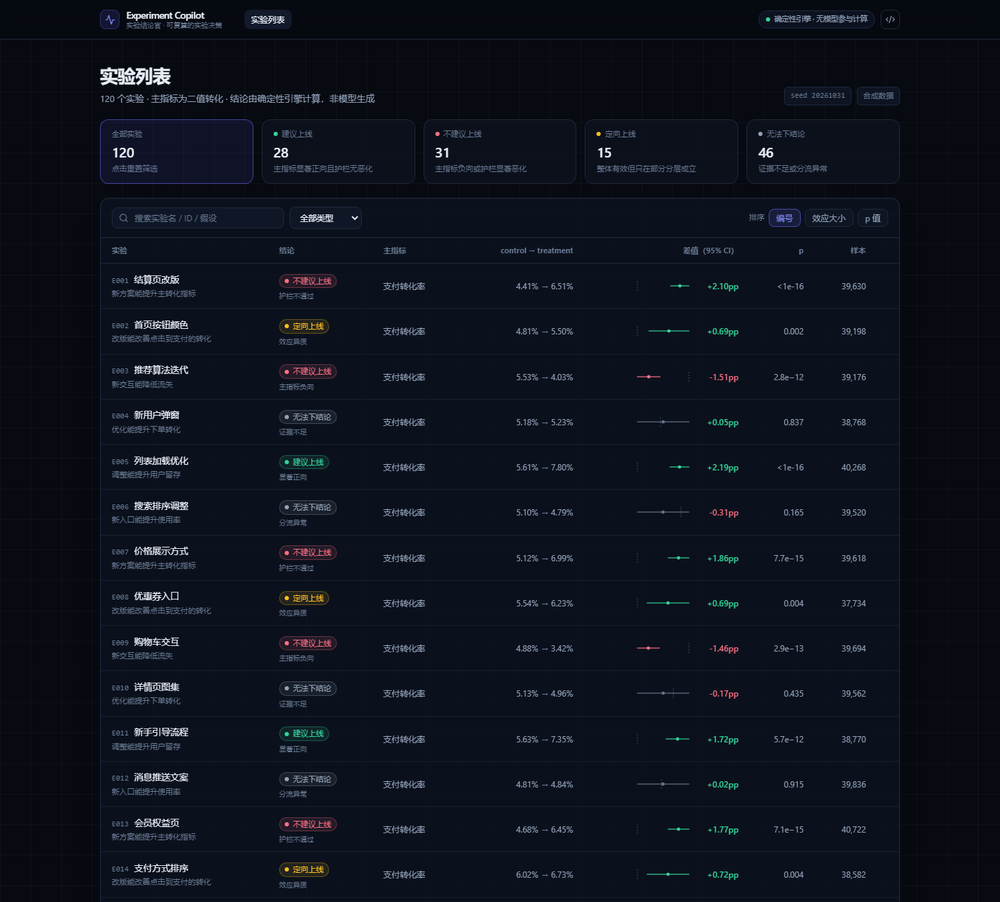

# Experiment Copilot · an auditable verdict for every A/B test

> Status: **M13 polish & delivery (UI side done: import persistence / experiment comparison / ⌘K search / light-dark themes / zero chart libraries)** ｜ 2026-11-01 ｜ Remaining: GitHub Pages deploy (deliberately last)
> Blueprint: [`docs/BLUEPRINT.md`](docs/BLUEPRINT.md) ｜ Measurements: [`docs/EVAL.md`](docs/EVAL.md) · [`docs/AUDIT-2026-11-01.md`](docs/AUDIT-2026-11-01.md) ｜ UI notes: [`docs/UI.md`](docs/UI.md) ｜ **Why these methods: [`docs/METHODOLOGY.md`](docs/METHODOLOGY.md)** ｜ Interview Q&A: [`docs/FAQ.md`](docs/FAQ.md) ｜ 中文版：[`README.md`](README.md)

**One line**: give it an A/B experiment, get back a **ship / don't ship** verdict you can audit.
Every statistic and every decision comes from a deterministic engine; the model only explains and answers follow-ups —
**any number can be expanded into its formula, sample size and data version, and the whole thing can be recomputed in one click.**



## Why this exists

Most "AI for analytics" projects stop at text-to-SQL. Experiment analysis has the opposite problem:
the statistics are well understood, but the **verdict** — ship it or not — is usually a human judgement
buried in a dashboard, with no way to check how it was reached.

So this project takes the narrow, checkable slice: **one experiment in, one auditable decision out**.
The value is not the model. The value is that the number can be recomputed and the reasoning can be refuted.

## We don't generate SQL. We produce a decision you can recompute.

| | Generic ChatBI / NL2SQL | Stats libraries (confidence, abba) | Experiment platforms (GrowthBook) | **This tool** |
|---|---|---|---|---|
| Main artifact | SQL and charts | Test results (p, CI) | A dashboard inside the platform | **A ship/no-ship card, plus why** |
| Role of the model | Writes SQL, participates in computation | None | None | **Explains and answers only; never touches a number** |
| Numbers expandable to formula + n | No | Only if you write the code | Metrics, maybe not the derivation | **Yes (step-by-step evidence chain)** |
| One-click recompute | No | Write a script | Re-run the pipeline | **Yes (same data, digit-by-digit diff)** |
| Hard pre-checks (SRM / sample size / guardrails) before significance | No | Build it yourself | Partial (guardrails need config) | **Yes, and before any verdict** |
| What it says when evidence is thin | Usually still a chart | Just a p-value | Significant / not | **"Not enough evidence" — explicitly** |
| Needs a backend or an account | Usually | No | Yes | **No (static site; import your own data)** |

> The three middle columns describe how such tools *typically* look. Versions differ a lot, and this is not a review of any
> specific repository. Every cell in the right column has a measurement behind it in the product or in `docs/EVAL.md`.

## Four principles

1. **LLM never does math.** Every number comes from the engine; the model is not allowed to compute.
2. **Every claim is reproducible.** Evidence drawer + one-click recompute, compared digit by digit.
3. **Check before concluding.** SRM, sample size and guardrails are evaluated before significance is discussed.
4. **Say "I don't know".** When evidence is insufficient, the card says so instead of rounding up to a story.

## Every screen (one table)

| Screen | What's in it | Screenshot |
|---|---|---|
| Experiment list | 120 experiments, five clickable stat tiles, filter + sort, inline mini-CI; filter state lives in the URL | [`01-实验列表.png`](docs/screenshots/01-实验列表.png) |
| Experiment detail | Verdict card, three hard pre-checks, forest plot, daily trend, metric detail, segments, guardrails, worked calculation, ground-truth comparison | [`02-实验详情-护栏拦截.png`](docs/screenshots/02-实验详情-护栏拦截.png) |
| Evidence chain | 9 evidence entries, **each expandable into step-by-step substitution** (① rates → ② SE → ③ z/p → ④ Newcombe CI → ⑤ threshold) | [`03-证据链-逐步代入.png`](docs/screenshots/03-证据链-逐步代入.png) |
| Rule trace | The verdict's evidence expands into 6 priority-ordered rules, marking hit / overridden / not triggered | [`04-规则判定轨迹.png`](docs/screenshots/04-规则判定轨迹.png) |
| Conclusion card export | One-click 2× PNG (880×552), ready to paste into a doc, resume or chat | [`05-结论卡导出.png`](docs/screenshots/05-结论卡导出.png) |
| Agent panel | Suggested questions, rule/LLM modes, tool-call trace, answers with clickable citations, number-audit badge | [`06-Agent-建议问题.png`](docs/screenshots/06-Agent-建议问题.png) · [`07-Agent-问答.png`](docs/screenshots/07-Agent-问答.png) |
| Eval dashboard | Confusion matrix, heterogeneity F1 with CI, hallucinated-number rate, buckets by archetype and by p-value, clickable failure cases, two calibration scopes | [`08-评测看板.png`](docs/screenshots/08-评测看板.png) |
| Ablation | Rule mode vs a real DeepSeek run, side by side (citation coverage / suspicious numbers / violations / scope / length) | [`09-Ablation对比.png`](docs/screenshots/09-Ablation对比.png) |
| Agent (LLM mode) | Real DeepSeek: 4 tool calls, clickable citations, number audit passed | [`10-Agent-智能模式.png`](docs/screenshots/10-Agent-智能模式.png) |
| Family-wise correction | A list-page switch: naive 68 → Holm 53 (15 retracted), each row labelled "not significant after Holm" with adjusted p | [`11-列表页-全局校正.png`](docs/screenshots/11-列表页-全局校正.png) |
| Expected loss | Four tiles + a net-value curve (break-even and point estimate both marked) + two sliders for k / MMP; gate vetoes in red, heterogeneity as an amber advisory | [`12-详情页-期望损失.png`](docs/screenshots/12-详情页-期望损失.png) |
| Import persistence | "Data source" chip: imported datasets live in IndexedDB, survive a reload, can switch back and forth, and can be deleted | [`13-导入持久化.png`](docs/screenshots/13-导入持久化.png) |
| Dimension slicing | Any string column in your table becomes a sliceable dimension (channel / city / version…), plus three built-ins including weekday-vs-weekend derived from the date. Effect heterogeneity across values uses **Cochran's Q** (one statistic, df = k−1) instead of pairwise comparisons — for k=2 it is exactly the squared diff-in-diff, so it is not a second methodology. Columns with more than 12 values are skipped **with the reason shown** |
| Editable metric dictionary | Direction / unit / formula / note are editable; labels are not (experiments store the Chinese label as `primaryMetric`). You can add **custom ratio metrics** (`Σnumerator / Σdenominator`, expression language restricted to arithmetic plus a field whitelist). Every save creates a new version with an auto-generated human-readable summary; history is read-only and rolling back creates yet another version |
| Optional backend (zero dependencies) | `npm run server`: scrypt passwords + httpOnly session cookie, RBAC (viewer/analyst/admin), an approval flow for decisions (you cannot approve your own, rejecting requires a reason), an append-only audit log, API tokens (plaintext shown once, only sha256 stored) and scheduled re-scans that alert when a verdict changes. Storage is atomic single-file JSON + JSONL audit — a backend that cannot install or compile is not a backend. Without it the frontend silently falls back to local mode and **never renders a fake permission page** |
| Robustness (winsorization) | A five-tier trim sweep with a sensitivity curve, revenue concentration, and single-row leverage (delete which row changes the verdict?). The panel states that **the trimmed p is not a significance conclusion**, with the simulation behind that statement | [`29-稳健性-去极值.png`](docs/screenshots/29-稳健性-去极值.png) |
| Experiment comparison | Tick two rows → same unit shares **one** x-axis (line length = uncertainty); different units (pp vs currency) are refused and stacked instead; 15 side-by-side rows | [`14-实验对比.png`](docs/screenshots/14-实验对比.png) · [`15-对比-不能同轴.png`](docs/screenshots/15-对比-不能同轴.png) · [`16-列表勾选对比.png`](docs/screenshots/16-列表勾选对比.png) |
| Command palette ⌘K | One panel over everything: experiments (id / name / hypothesis / **rule names**), metric names, and app actions; multi-word is AND, an exact id always ranks first, ↑↓ + ↵ works end to end | [`17-全局搜索.png`](docs/screenshots/17-全局搜索.png) · [`18-全局搜索-功能分组.png`](docs/screenshots/18-全局搜索-功能分组.png) |
| Theme | Light / dark / follow-system, one button to cycle; **every colour is a CSS variable**, so SVG charts switch together with the cards — never "dark cards, light charts" | [`19-深色模式.png`](docs/screenshots/19-深色模式.png) · [`20-深色模式-对比.png`](docs/screenshots/20-深色模式-对比.png) |

**Demo video (52s, Chinese narration)**: [`deliverables/video/Experiment-Copilot-演示.mp4`](deliverables/video/Experiment-Copilot-演示.mp4) — 10 real-usage segments: refuse to conclude → guardrail block → step-by-step evidence → worked calculation → expected loss → two experiments on one axis → ⌘K → eval dashboard.
**Portfolio page**: [`portfolio/index.html`](portfolio/index.html) — a single 4.2MB file with the 52s video and 9 inline 1600px screenshots, plus scroll parallax (layered hero, in-view reveals, reading progress bar; disabled under `prefers-reduced-motion`).

Deep links: `#/e/E001` opens an experiment, `#/e/E001?ev=E6` expands the 6th evidence entry, `#/?d=ship&s=diff` restores a filtered view.

Two things the detail page has that demos usually don't:

- **A "worked calculation" tab**: `p̂ = c/n`, `SE = √(p̄(1−p̄)(1/n₁+1/n₂))`, `z`, the Newcombe interval and the SRM chi-square,
  all with numbers substituted in, so any line can be re-derived by hand.
- **Ground-truth comparison** (collapsed): the synthetic data has injected effects, so the page can put
  "engine verdict vs true verdict" side by side — including the ones that disagree.

## Quick start

```bash
npm install
npm run dev        # local dev (regenerates data first)
npm run build      # dist/ (tsc --noEmit + vite build)
npm run preview    # preview the build

npm test           # 547 unit tests (stats / decisions / evidence / card export / agent / tool loop / eval scope /
                   #   import parsing / A-A calibration / metric dictionary / configurable thresholds / CUPED /
                   #   sequential / novelty / multiplicity / A-B-n multi-arm / winsorized robustness / expected loss / comparison /
                   #   forest scaling / ⌘K /
                   #   methodology cross-check / days-to-significance / multi-turn / ARPU / heterogeneity F1 / baseline)
npm run eval       # eval report: heterogeneity F1 + hallucinated-number rate over 2200 Agent Q&A
npm run eval:check # compare against eval/baseline.json; any drift exits 1 (this is what CI runs)
npm run ablation   # rule mode vs LLM, writes docs/ABLATION.md (needs DEEPSEEK_API_KEY)
npm run smoke      # UI smoke (needs npm run build && npx vite preview --port 4321)
                   #   drives a real browser: blank screen / undefined / NaN / uncaught errors all fail the run
npm run gen        # regenerate the 120 experiments from the fixed seed
npm run calibrate  # 120-case calibration: confusion matrix + five metrics
npm run aa         # A/A self-calibration over 2000 zero-effect experiments
npm run cuped      # CUPED variance reduction + robust standard errors
npm run seq        # sequential testing: false-positive rate under repeated looks
npm run novelty    # novelty effect: A/A calibration + detection rate on injected decay
npm run fwer       # multiplicity: FWER simulation + Holm/BH on the 120 experiments
npm run multiarm   # A/B/n: all-null naive vs Dunnett false-positive rate, winner-pick rate, P(best) calibration
npm run robust     # winsorization: raw vs trimmed bias/MSE/CI coverage under heavy tails, and what granularity does to it
npm run server     # optional zero-dependency backend: auth/RBAC/approvals/audit/API/alerts, also serves dist/
npm run loss       # expected loss: gates + net value vs the frequentist rule, on realised truth
npm run forecast   # "how many more days" across the 120 experiments
npm run method     # every number quoted in the methodology doc
```

After it loads: press ⌘K / Ctrl+K for search; the list page → any experiment → "evidence chain" (top right) → "recompute" (bottom).

## Import your own data (no rebuild)

Top right → **"导入数据" (Import)** → choose JSON or CSV → paste or upload → **"载入并分析"**.
All of it happens in the browser: nothing is uploaded, nothing goes through the model, and the same deterministic
engine runs on it immediately.

### JSON

Needs `experiments` and `daily`:

```json
{
  "experiments": [
    { "id": "exp_001", "name": "New homepage", "primaryMetric": "conversions",
      "archetype": "positive", "trueLiftOverall": 0.012, "trueDecision": "ship" }
  ],
  "daily": [
    { "expId": "exp_001", "date": "2026-01-05", "variant": "control", "device": "iOS",
      "tenure": "new", "exposures": 5000, "conversions": 260, "refunds": 60,
      "complaints": 5, "latencyP95": 800 }
  ]
}
```

- Required: experiment `id`; daily `expId / date / variant / exposures / conversions`.
- `variant` accepts aliases: `control/treatment`, `对照/实验组`, `A/B`, `0/1`.
- `device` must be `iOS/Android`, `tenure` must be `new/old`; when absent the row goes into a single default stratum
  (still analysable, just without segmentation).
- If every experiment carries `trueDecision` and `trueLiftOverall`, the eval dashboard keeps its accuracy / confusion /
  calibration views.
- **A whole missing column is never silently filled with 0.** With no `refunds` column, the refund guardrail reads
  "unavailable (column missing)", the hard-check reads "not applicable", the evidence chain says "not evaluated",
  and it is excluded from the decision ([screenshot](docs/screenshots/22-缺列-护栏不可用.png)).
  Missing `revenue` falls back to the conversion-rate metric and says so.
  Why it matters: filling 0 would print "0.00% → 0.00%, not worse", which reads as *checked, all good* when the truth is *no data*.

### CSV (daily grain; one row = one day × one variant × one stratum)

```
expId,date,variant,device,tenure,exposures,conversions,refunds,complaints,latencyP95,revenue,name
exp_001,2026-01-05,control,iOS,new,5000,260,60,5,800,18200,New homepage
exp_001,2026-01-05,treatment,iOS,new,5000,320,62,6,810,22400,New homepage
```

- Required columns: `expId, date, variant, exposures, conversions`; the rest are optional.
- Experiment metadata (name, date range, which guardrails exist) is derived from the rows.
  For ARPU, add `primaryMetric` + `metricType=continuous` and a `revenue` column.

### Imported data vs synthetic data

Real business data usually has **no known truth**, so `groundTruth = false` and the eval dashboard **hides** every
metric that needs it (accuracy, confusion matrix, calibration curves) — a meaningless number is worse than no number.
The list, detail page, evidence chain, Bayesian view and Agent keep working.

## Layout

```
src/lib/stats.ts        Statistics engine (zero dependencies): SRM / two-proportion z / Newcombe CI / Wilson / BH /
                        power / Welch / Beta-Binomial / non-inferiority / Bootstrap(BCa) / CUPED + robust SE
src/lib/decide.ts       Decision engine: 6 priority-ordered rules + evidence-chain generation
src/lib/forecast.ts     "How many more days": point extrapolation + probability simulation
src/lib/config.ts       Every threshold (α / FDR / guardrail margins / SE mode / CUPED switch / bootstrap reps)
src/lib/metrics.ts      Metric dictionary (single source): definition / direction / unit / formula / method / margin
src/lib/simulate.ts     Data generator (fixed seed, 6 archetypes, day/device/arm-level heterogeneity)
src/lib/import.ts       JSON / CSV parsing (column normalisation + row-level error messages)
src/lib/compare.ts      Comparability rules for the side-by-side view (pure; units decide the axis)
src/lib/methodology...  (see docs/METHODOLOGY.md — the numbers come from scripts/method_numbers.ts)
src/lib/agent/          Agent: 16 pure-function tools / rule router + multi-turn completion / number audit
src/app/                UI: Vite + React 19 + TS + Tailwind v3
  components/Forest.tsx         Hand-written SVG forest plot
  components/Trend.tsx          Hand-written SVG daily trend (hover snapping; no chart library)
  components/CompareScreen.tsx  Two experiments on one shared axis, or a refusal
  components/CommandPalette.tsx ⌘K palette (keyboard-only path works end to end)
scripts/                Generation / calibration / data export / screen recording / video / portfolio build
tests/                  547 unit tests (6 scipy-aligned cases + coverage/Bootstrap/non-inferiority/A-A/CUPED
                        simulations + metric dictionary/configurability/multi-turn + heterogeneity F1/baseline self-test)
eval/baseline.json      Regression baseline: 86 metrics + a data fingerprint
data/                   120 experiments / 6,720 rows
docs/                   Blueprint / methodology / data notes / eval report / UI notes / FAQ / screenshots
```

## What's built (and what it measured)

Everything below was measured on this repository, with a fixed seed, and can be reproduced with the command in the
right-hand column of `docs/EVAL.md`.

| Area | Result |
|---|---|
| Decision accuracy | **93.3%** (112/120) against injected ground truth; four-way exact match required |
| Null false-positive rate | **5.0%** (2/40); denominator is `archetype=null` only — SRM experiments are a different failure mode, and mixing them in would flatter the number |
| Effect-direction misses | 0% on negatives (0/30), 4.0% on positives (1/25 — E029, cause documented) |
| Near-threshold accuracy | **42.9% (3/7)** for p ∈ 0.01–0.05. Published as its own metric; not "fixed" by moving α |
| A/A self-calibration | **6.35%** over 2000 zero-effect experiments (rate 6.20%±1.49pp / continuous 6.50%±1.53pp) |
| Naive vs robust SE | The textbook `p(1−p)/n` pushes the rate-metric A/A false-positive rate to **9.70%**; the cell-level robust SE brings it back to **6.20%** |
| CUPED | Median variance reduction **7.24%** (rate 7.00% / continuous 10.14%; ρ=0.271, φ=1.24) |
| Heterogeneity detector | F1 **0.857** (P 0.923 / R 0.800, 15 positives), 95% CI 0.67–0.97; relaxing the rule drops F1 to 0.788 |
| Hallucinated numbers | **0 of 13546** numbers across 2200 rule-mode answers; citation coverage 100% (denominator 1840 — answers with no citable evidence are excluded) |
| Tool coverage | **16/16** tools reached by an 18-question bank |
| Sequential testing | Peeking daily for 7 days: naive false-positive **16.37%** → O'Brien–Fleming **4.93%**; mSPRT costs 3.09σ for "look whenever you want" (0.52%) |
| Novelty effect | A/A false positives **4.8% (rate) / 6.4% (ARPU)**; the first version of this detector measured 12.0% / 15.0%, and that is documented rather than deleted |
| Multiplicity | All-null family: "at least one significant" = **99.79%** (1−0.95¹²⁰). On real data naive 68 → Holm **53**, and 5 of the 15 retracted ones had zero injected effect |
| A/B/n multi-arm | Every treatment arm is compared against the shared control with **Dunnett** simultaneous inference (exact 1-D Gauss–Hermite quadrature after conditioning on the control mean). All-null false-positive rate over 20000 runs: naive **9.41% (3 arms) / 12.75% (4 arms)** vs Dunnett **5.34% / 5.04%**; critical z 2.212 / 2.349 / 2.442 matches the published tables. At 4 arms Bonferroni needs a 2.394 boundary vs Dunnett's 2.353 (40606 vs 41657 per arm, i.e. **2.6% more**) because it ignores the positive correlation induced by the shared control — a modest but real gain, so both numbers are shown side by side rather than claimed as a win |
| Winsorized robustness | ARPU only, and deliberately **not** a second significance test. Trimming reduces MSE from **4.89 → 1.23** under heavy tails (κ=200), but the trimmed 95% interval covers the true ARPU difference only **33.67%** of the time while the raw delta-method interval still covers **94.67%** — it estimates a different quantity, so its p-value is labelled `p*` and never feeds the decision. Tail weight barely moves the raw interval (94.67%–96.67% across κ=1…200); what it does inflate is the point estimate's absolute bias (0.600 → 1.758 yuan). Detection goes 3.67% → 68.67% after trimming, which is a change of hypothesis, not a gain in power. Granularity decides whether trimming does anything at all: one user per row cuts bias 54.9%, five users per row 12.9%, fifty users per row 3.0% |
| Expected loss | Gates + net value **20.182** vs the frequentist rule 15.696 (+25.4% / +28.6%); the ungated rule scores higher (23.978) but would ship 15 experiments whose refund rate went **1.19% → 2.03% (1.71×)** |
| Interval choice | Newcombe instead of Wald: at a 0.12% baseline with n=30 both cover 100%, but the widths are **0.906pp vs 22.869pp** |
| Chart scaling bug | The forest plot's pp axis drew **341 grid lines** (step computed in percentage points, start in percent). Fixed, and locked by 6 tests |
| Comparability | 120 experiments × all pairs = **7140 pairs**, asserting "shared axis ⟺ same unit" — not a sample |
| Unit tests | **547** across 42 files; 6 z-test cases aligned with scipy (relative error < 1e-4) |
| Regression baseline | **86 metrics** + data fingerprint in `eval/baseline.json`; `npm run eval:check` exits 1 on any drift |
| Bundle | **742KB** JS / 241KB gzip, zero chart libraries, zero backend |

## Why these methods (every choice comes with its cost)

`docs/METHODOLOGY.md` is written the same way for every choice:

> what the alternative was → under which conditions it breaks → how expensive that is → what we chose →
> **and where our own choice breaks too** (that last part is not optional).

| Choice | Rejected alternative | Why |
|---|---|---|
| **Newcombe method 10** for the difference CI | Wald | With zero events in both arms Wald returns `[0, 0]` — width 0, i.e. "the effect is exactly zero". At a 0.12% baseline with n=30 both intervals cover 100%, but the widths are **0.906pp vs 22.869pp**: coverage is not the criterion, width is. On the realistic case (1.19% vs 1.24%, 20k/arm) Newcombe costs **0.002pp** of width |
| **Holm** for the list, **BH q=0.1** for segment scans | No correction / Bonferroni / BH everywhere | With 120 all-null experiments, "at least one significant" is **99.79%** — arithmetic, not luck. At m=2, BH(q=0.1)'s threshold for the smallest p is exactly α=0.05, so the FDR control is free |
| Only the **refund rate** is a hard gate, mode `harm_and_practical` | `non_inferiority` / `confirm_beyond_margin` | On the dataset `non_inferiority` blocks **15** experiments that shouldn't be blocked (the metric improved, the guardrail just can't prove it didn't), and `confirm_beyond_margin` misses **27.7%** of the real harm in simulation. Complaints (0.12% baseline) have an SE equal to 29% of the baseline — any business-meaningful margin is smaller than the noise |
| **Normal approximation** for P(B>A) | Exact Beta integration / MCMC | Error ≤ **0.08pp** once each arm has ≥1000 (1.01pp at n=20, which is why small-sample digits are explicitly marked "not quotable"); closed-form and **same-sourced** as the credible interval and the expected loss, so the card can never say "97% likely better" next to an interval crossing zero |

Two examples of the last part of the rule, both in the document with numbers: Newcombe covers **90.8%** at p≈0.5
with n=30 — *worse* than Wald's 94.8%; and the segment scan's `q=0.1` changes nothing at all when swept from 0.05
to 0.2, because the detector's conjunction is the real bottleneck, not q. A methodology with no stated costs usually
means the author hasn't found where it breaks yet.

## Does the model actually help? (ablation, 24 questions × 3 experiments)

| Metric | Rule mode (no key) | LLM mode (deepseek-flash) |
|---|---|---|
| Citation coverage | 100% | **94.7–100%** (6 runs, 5 at 100%) |
| Suspicious-number rate | 0% | **0–0.6%** (6 runs, 4 at 0) |
| Violation rate | 0% | **0–8.3%** (2 runs caught 1–2 each) |
| Scope-trap recognition | 100% | **100%** |
| Mean length | 176 chars | 274 chars |

The first real-model run had a 1.8% suspicious-number rate — **not** hallucination: the model copied a 16-digit
float (`0.02099419631592228`) straight out of a tool result. Fixed on both sides (formatted fields like `diffPP` /
`pText` in the tools, plus a prompt rule against long decimals), and the rate went to 0.
Two of the six runs did **not** come out clean, and they are documented in `docs/ABLATION-NOTES.md` rather than
re-run until they looked good: one wrote `4.2e-13` as `1e-13`, one computed `0.26` that the engine never produced.

## What broke along the way (seven that mattered)

Every one of these was found by measurement or by looking at the rendered screen — not by reading the code again.

| Bug | How it surfaced | What it taught |
|---|---|---|
| `p(1−p)/n` overstates precision on rate metrics; A/A false positives hit **9.70%** | 2000 zero-effect experiments | A 96.7% accuracy number was partly bought with over-optimistic intervals. Fixed by `seMode='robust'`, not by CUPED |
| The forest plot's pp axis drew **341 grid lines** | Comparing two charts on one axis looked "suspiciously aligned" | Rendered output looked like an intentional striped background and the tick labels were pushed off-canvas, so "the numbers looked right" because the wrong ones weren't visible |
| The novelty detector's first version had A/A false positives of **12.0% / 15.0%** | 1000 all-null experiments | Half a window is 3–4 days; any same-day SE misses day-to-day drift. Day-level clustering + Welch t brought it to **4.8% / 6.4%** |
| 48 "unsourced numbers" in rule mode | The automatic eval, not the human ablation | The audit whitelist accepted numbers but not strings, so `mdeNowText: "0.63pp"` was flagged. **If a metric isn't automated, it stays at "I believe it's zero"** |
| A dataset missing `refunds` printed "0.00% → 0.00%, not worse" | Writing the FAQ — the claim "missing columns are never fabricated" was false | Filling 0 turns "no data" into "checked, fine". Now it reads "unavailable (column missing)" / "not applicable" / "not evaluated" and is excluded from the decision |
| Trimming 1% clipped **exactly zero rows** yet reported "conclusion stable" | The first run on real ARPU data: `clippedHigh` was 0 in every tier | The quantile was weighted by exposures while a single row already held 1.8% of traffic, so the boundary always landed *inside* that row. The "robustness check" had checked nothing and declared a pass — **worse than not running it**. Switching to one vote per row also matches `ratioTest`'s own sampling model |
| Simulation showed detection jumping **3.67% → 68.67%** after trimming; it almost went into the README as a win | Looking at the same tier's interval coverage: **20.67%** | What jumped was detection of a *different hypothesis*. Trimming changes the estimand, not the precision. Quoting only the flattering number is self-confirmation — so all four numbers are now reported side by side |

## The bar

This is not a demo that renders three charts. The acceptance criteria are the ones a flagship tool would be held to:

- **Every number is reversible**: expand to formula → sample size → data version → recompute and diff.
- **Every claim is falsifiable**: 547 tests, an 86-metric regression baseline, a UI smoke run that drives a real browser,
  and an automatic eval that fails the build when a metric drifts.
- **Every method states its cost**, including the cases where our own choice is worse than the textbook one.
- **No silent fallbacks**: missing columns, missing ground truth, an unavailable model, an exhausted storage quota —
  each one is a visible state, never a zero that looks like a result.

## Tech stack

Vite 8 + React 19 + TypeScript + Tailwind CSS **v3** (not v4: its range-syntax media queries break on Chrome < 104).
**Zero chart libraries** — the forest plot and the daily trend are hand-written SVG (the trend used to be Recharts;
removing it took the bundle from 915KB → 573KB, gzip 286KB → 187KB; multi-arm, robustness and the import layer have since brought it to 742KB / 241KB gzip). Statistics are in-house with tests. **No backend by default** (Pages serves the static build);
there is an optional zero-dependency backend for roles/approvals/audit/API/alerts. The Agent talks to DeepSeek directly from the browser, and the site deploys as static files.

## Milestones

M1 data + stats ✅ → M2 verdict card UI ✅ → M3 verifiable evidence ✅ → M4 Agent ✅ → M5 eval dashboard ✅ → M6 demo ✅ →
M8 statistical depth ✅ → M9 product completeness ✅ → M10 differentiation (CUPED / ARPU / days-to-significance / multi-turn) ✅ →
M11 evaluation loop (hallucination rate / heterogeneity F1 / baseline / CI) ✅ →
M12 sequential & advanced (sequential / novelty / multiplicity / expected loss) ✅ →
**M13 polish & delivery (import persistence ✅, comparison ✅, ⌘K ✅, themes ✅, no chart libs ✅, methodology ✅, FAQ ✅)** →
**M14 A/B/n multi-arm (Dunnett / P(best) / multi-arm planning / multi-arm import) ✅** →
**M15 winsorized robustness (trim sweep / revenue concentration / single-row leverage) ✅** →
**M16 dimension slicing, editable metric dictionary, optional backend (RBAC / approvals / audit / API / alerts) ✅** →
G2 Pages deploy (deliberately last).

Acceptance criteria live in the blueprint (§13); the extension list and measurements live in
[`docs/AUDIT-2026-11-01.md`](docs/AUDIT-2026-11-01.md).

---

中文版：[`README.md`](README.md)
