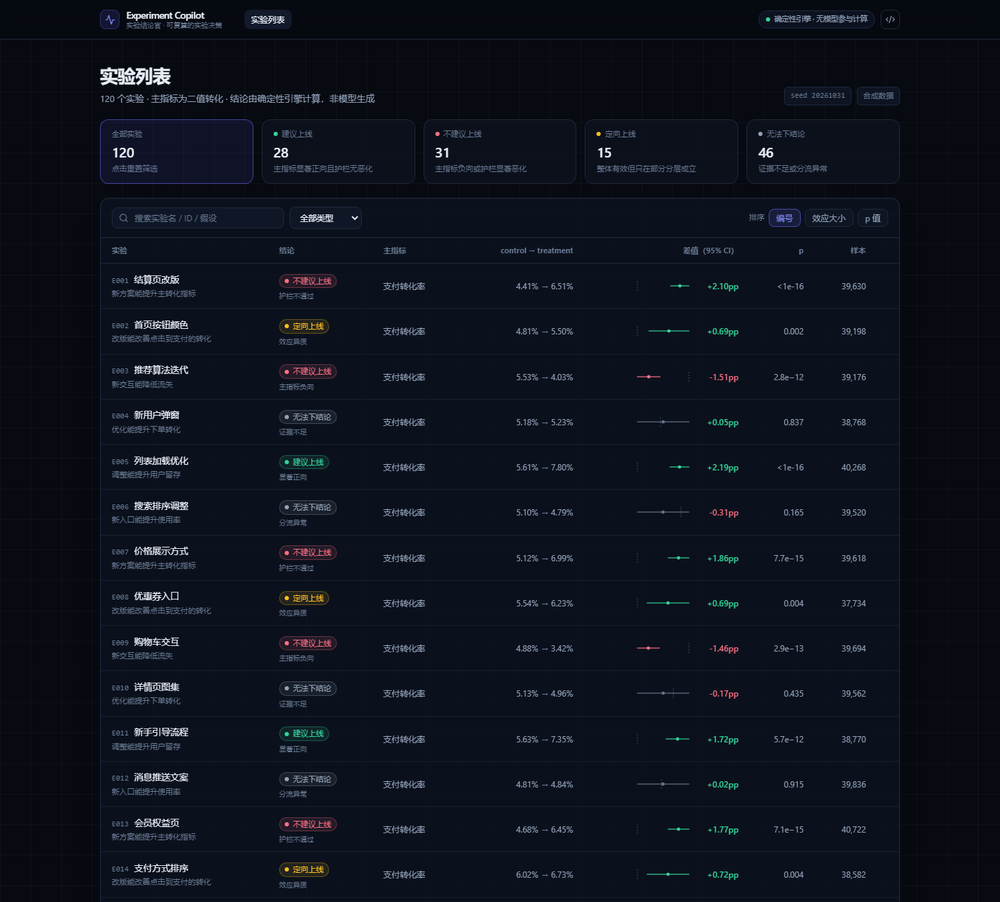

# Experiment Copilot · 实验结论官

> 状态：**M3 完成（证据链可验算：逐步代入 + 规则轨迹 + 结论卡导出 + 视图/证据深链）** ｜ 2026-10-31
> 方案：[`docs/BLUEPRINT.md`](docs/BLUEPRINT.md) ｜ M1 评测：[`docs/EVAL.md`](docs/EVAL.md) ｜ UI 说明：[`docs/UI.md`](docs/UI.md)

**一句话**：输入一个 A/B 实验，输出一张「能不能上」的可审计结论卡。
统计与决策全部由确定性引擎完成，模型只负责解释与追问——**每个数字都能点开看公式、样本量与数据版本，并能一键复算。**



## 为什么做这个

- 15 份目标 JD 里，**「数据分析 SQL/统计」出现 9/15**，是唯一还没有独立项目覆盖的高频项。
- GitHub 现状：通用 ChatBI 已挤爆（Vanna 23.8k / pandas-ai 23.9k / Chat2DB 28.3k / WrenAI 18k），
  而**实验分析只有统计库（confidence 312、abba 241）和平台（GrowthBook 8.5k），没有 AI 层**。
- 定位差异：不做 NL2SQL、不做 ChatBI，做「**可复算的实验决策**」。

## 四条原则

1. LLM never does math（所有数字来自引擎，模型不参与计算）
2. Every claim is reproducible（证据抽屉 + 一键复算）
3. Check before conclude（先 SRM / 样本量 / 护栏，再谈显著性）
4. Say "I don't know"（证据不足就说无法下结论）

## 三个屏

| 屏 | 关键内容 | 截图 |
|---|---|---|
| 实验列表 | 120 个实验、5 个可点击统计块、筛选与排序、迷你 CI；筛选状态写进 URL | [`01-实验列表.png`](docs/screenshots/01-实验列表.png) |
| 实验详情 | 结论卡 + 三条硬前置检查 + 森林图 + 趋势 + 指标/分层/护栏/计算过程 | [`02-实验详情-护栏拦截.png`](docs/screenshots/02-实验详情-护栏拦截.png) |
| 证据链 | 9 条证据时间线，**每条都能展开看逐步代入**（① 转化率 → ② SE → ③ z/p → ④ Newcombe CI → ⑤ 判定阈值） | [`03-证据链-逐步代入.png`](docs/screenshots/03-证据链-逐步代入.png) |
| 规则轨迹 | 结论那条证据展开后是 6 条规则按优先级依次判断，标出命中/被覆盖/未触发 | [`04-规则判定轨迹.png`](docs/screenshots/04-规则判定轨迹.png) |
| 结论卡导出 | 一键导出 2 倍图 PNG（880×552），可直接贴文档/简历/群聊 | [`05-结论卡导出.png`](docs/screenshots/05-结论卡导出.png) |

深链：`#/e/E001` 直达实验，`#/e/E001?ev=E6` 直接展开第 6 条证据，`#/?d=ship&s=diff` 还原筛选视图。

详情页里两个「别的 demo 没有」的东西：

- **计算过程 Tab**：把 `p̂ = c/n`、`SE = √(p̄(1−p̄)(1/n₁+1/n₂))`、`z`、Newcombe 区间、SRM 卡方的**代入数值**全摊开，任何一条都能手算核对。
- **真值对照**（折叠）：合成数据注入过真实效应，所以可以把「引擎判定 vs 真实决策」放在页面上——包括不一致的那几个。

## 快速开始

```bash
npm install
npm run dev        # 本地开发（自动先跑 npm run data）
npm run build      # 生成 dist/（含 tsc --noEmit + vite build）
npm run preview    # 预览构建产物

npm test           # 27 个单测（统计 / 决策 / 证据推导 / 导出卡片）
npm run gen        # 用固定种子重新生成 120 个实验（data/）
npm run calibrate  # 120 例校准：混淆矩阵 + 五项指标
```

打开后：列表页点任意实验 → 详情页 → 右上角「证据链」→ 底部「一键复算」。

## 目录

```
src/lib/stats.ts        统计引擎（零依赖）：SRM / 两比例 z / Newcombe CI / Wilson / BH / 功效 / Welch
src/lib/decide.ts       决策引擎：6 条规则的优先级 + 证据链生成
src/lib/simulate.ts     数据生成器（固定种子，6 类原型）
src/app/                UI：Vite + React 19 + TS + Tailwind v3
  components/Forest.tsx        手写 SVG 森林图（比图表库更可控）
  components/Trend.tsx         Recharts 分日趋势
  components/ExperimentList.tsx / ExperimentDetail.tsx / EvidenceDrawer.tsx
scripts/                生成 / 校准 / 导出前端数据
tests/                  18 个单测（含 6 组 scipy 对齐）
data/                   120 个实验 / 6,720 行；另有 6 个手工核对过的 seed（xlsx）
docs/                   蓝图 / 数据需求 / 数据修正记录 / M1 评测 / UI 说明 / 截图
```

## 已完成

### M1 — 数据 + 统计 + 决策 + 校准

| 模块 | 内容 |
|---|---|
| 统计引擎 | SRM 卡方、两比例 z、Newcombe 差值 CI、Wilson、BH 多重比较、功效/MDE、Welch |
| 决策引擎 | 6 条优先规则 → `ship / no-ship / iterate / inconclusive` + 证据链 |
| 数据生成器 | 120 实验 / 6,720 行，固定种子可复现（null 40 / positive 25 / guardrail 15 / heterogeneous 15 / negative 15 / srm 10） |
| 单测 | 18 个全绿，6 组 z 检验 p 值与 scipy 相对误差 < 1e-4 |
| 校准 | **决策准确率 96.7%**（116/120）、null 误报 7.5%、正负效应漏判 0%、异质/ SRM / 护栏识别 100% |

> 剩下 4 例全是 null 实验在 α=0.05 下的正常假阳性，**故意不修**——评测看板要如实展示失败案例。

### M2 — 结论卡 UI + 证据链

| 模块 | 内容 |
|---|---|
| 列表 | 120 行、5 个可点击统计块、搜索 / 类型 / 排序、行内迷你 CI |
| 详情 | 结论卡、三条硬前置检查、森林图、7 日趋势、指标明细、分层（含 BH q）、护栏、计算过程、真值对照 |
| 证据链 | 侧滑抽屉、9 条证据、数据口径表、一键复算（逐项比对，0.1–0.3ms） |
| 交互 | hash 路由可直接分享单实验链接、Esc 关闭抽屉、响应式（1440 / 1024 / 820 均验过） |

### M3 — 让证据链可验算

| 模块 | 内容 |
|---|---|
| 逐步代入 | 每条证据自带 3–5 步推导（公式 + 实际数值），护栏复用真实 z / CI，不构造占位值 |
| 规则轨迹 | 引擎输出 `rules: 6 条规则 × (条件, 明细, 是否命中)`；抽屉里高亮命中项，标出「被更高优先级覆盖」 |
| 结论卡导出 | 手写 SVG → canvas → PNG（2 倍图），零第三方截图库；卡片高度随理由行数自适应 |
| 深链 | 列表筛选写回 URL（`replaceState`，不触发 hashchange）；证据级深链 `?ev=E6` 自动展开并滚动到可视区 |
| 单测 | 27 个（新增 9 个）：推导数值必须对得上引擎、规则轨迹恰好命中一条、护栏 z 不得为占位 0、SVG 不得含 undefined/NaN |

## 技术栈

Vite 8 + React 19 + TypeScript + Tailwind CSS **v3**（不用 v4：其区间语法媒体查询在 Chrome<104 失效）+ Recharts（仅趋势图）；
森林图手写 SVG；统计自研带单测；无后端、无数据库。后续 Agent 走 DeepSeek 浏览器直连，部署 GitHub Pages。

## 里程碑

M1 数据+统计 ✅ → M2 结论卡 UI ✅ → **M3 证据链可验算 ✅** → M4 Agent（8 工具 + 5 铁律）→ M5 120 例评测看板 → M6 打磨/部署/视频。
验收标准见蓝图 §13。
